# AI Assignment Grader — n8n workflow for automated grading

[](LICENSE)
[](https://n8n.io)
[](https://docs.docker.com/compose/)

An **n8n** workflow that grades student assignments automatically. The lecturer submits one Google Drive
folder with the students' work; the system downloads the files **one at a time**, renders PDFs into images,
sends the exam sheet + answer key + every answer page to a **vision** LLM in a **single call per file**, and
writes the results to Google Sheets — finishing with one `DONE` summary row.

- Main artifact: [`penilai-otomatis-tugas.json`](penilai-otomatis-tugas.json) — import this file into n8n.
- Render sidecar: [`compose.media.yml`](compose.media.yml) + [`media-helper/`](media-helper/) — PDF → JPEG.
- **No credentials are included** in this repository; connect your own accounts after importing (see [Installation](#installation)).

## Table of contents

- [Features](#features)
- [How it works](#how-it-works)
- [Components](#components)
- [Requirements](#requirements)
- [Installation](#installation)
- [Form fields](#form-fields)
- [File naming & student identity](#file-naming--student-identity)
- [Grading rubric & weights](#grading-rubric--weights)
- [Behavior & limits](#behavior--limits)
- [Advanced configuration](#advanced-configuration)
- [Repository structure](#repository-structure)
- [Troubleshooting](#troubleshooting)
- [Security & privacy](#security--privacy)
- [License](#license)

## Features

- **One AI call per file** — exam sheet, lecturer answer key, and all answer pages are sent together as a
  single multimodal (image) request, not one call per question.
- **PDF & image support** — PDFs are rendered to JPEG by the bundled sidecar; JPG/PNG files are normalized directly.
- **Flexible answer key** — the key can live inside the exam file (read by the model) or be pasted into the form.
- **Optional per-question weights** — enter weights in the form and the final score is weighted automatically.
- **Deterministic multiple choice** — chosen letters are compared against the key **by code**, not by the model.
- **Identity from the file name** — student ID and name are parsed deterministically from `NIM_Name` /
  `Name_NIM` patterns, including format validation, duplicate detection, and digit-length consistency checks.
- **`NEEDS REVIEW` safety marker** — blurry pages, invalid responses, ID problems, or transport failures never
  stop the run; the row is still written without a score, together with the reason.
- **`DONE` closing row** — a summary line with the number of graded files is appended when the loop finishes.
- **Keyless, portless sidecar** — read-only container with no host port, no outbound network, and CPU/memory limits.

## How it works

```mermaid
flowchart LR
    F[Grading Form<br/>folder + exam + key + weights] --> PR[Prepare Reference]
    PR --> CET{Check Exam Type}
    CET -->|PDF| REP[Render Exam PDF<br/>sidecar]
    CET -->|image| NEI[Normalize Exam Image]
    REP --> BR[Build Reference]
    NEI --> BR
    BR --> LS[List Submission Files] --> FI[Filter PDFs and Images] --> POF[Process One File<br/>one file per iteration]
    POF -->|per file| DBF[Delay Between Files] --> DF[Download File] --> CFT{PDF?}
    CFT -->|Yes| RSP[Render Student PDF<br/>sidecar] --> MPP[Merge PDF Pages]
    CFT -->|No| NSI[Normalize Student Image]
    MPP --> BAR[Build AI Request]
    NSI --> BAR
    BAR --> CAM[Call AI Model] --> RES[Build Result<br/>student ID + weights] --> SGS[Save to Google Sheets] --> POF
    POF -->|done| SR[Summarize Run] --> CR[Closing Row<br/>DONE row in the sheet]
```



## Components

| Component | Role |
|---|---|
| n8n workflow (`penilai-otomatis-tugas.json`) | Orchestrates everything: form validation, file listing, rendering, AI calls, writes scores. |
| Media sidecar (`project2-media`) | Small HTTP service (`POST /render-pdf`, `GET /health`) that turns PDFs into JPEG pages using Poppler. |
| Google Drive (OAuth2) | Source of the exam file and the students' submission folder. |
| Google Sheets (OAuth2) | Destination for the grading results. |
| OpenAI-compatible AI endpoint | Must support **image input (vision)**; one call per file. |

## Requirements

- **n8n** running in Docker (tested on n8n 2.42.x) with its default task runner enabled.
- **Docker + Docker Compose** on the same host as n8n (for the media sidecar).
- **A Google account** with access to the Drive folder and the target spreadsheet (OAuth2 for Drive & Sheets).
- **An OpenAI-compatible AI endpoint with vision support** — your own router/gateway, OpenRouter, or an
  institutional endpoint. The URL shipped in the workflow (`Call AI Model`) is only an **example**; replace it
  with your own endpoint.

## Installation

### 1. Clone the repository

```bash
git clone https://github.com/0xMinomus/n8n-vision-grader.git
cd n8n-vision-grader
```

### 2. Start the media sidecar (PDF → images)

The sidecar must join **the same Docker network as the n8n container**. The compose file defaults to an
external network named `n8n_default` (the default docker-compose network name for n8n).

```bash
# Check your n8n network name first:
docker inspect -f '{{range $k,$v := .NetworkSettings.Networks}}{{$k}}{{"\n"}}{{end}}' <n8n-container-name>

# If it is not n8n_default, edit the `name: n8n_default` line in compose.media.yml, then:
docker compose -f compose.media.yml up -d --build
```

Verify the sidecar from the same network:

```bash
docker run --rm --network n8n_default curlimages/curl -s http://project2-media:8080/health
# → {"status": "ok", "media_version": "media-v3", ...}
```

The sidecar publishes no host port, holds no API keys, runs read-only, and is limited to 1 CPU / 512 MB.

### 3. Import the workflow into n8n

In n8n: **Workflows → … → Import from File →** select `penilai-otomatis-tugas.json`
(or grab a copy from the [Releases](../../releases) page). The workflow is imported as **inactive**.

### 4. Create the credentials (3 of them)

This repository ships **without any credentials**. Create new credentials in n8n and select them on the
matching nodes:

| Credential | n8n type | Used by | Notes |
|---|---|---|---|
| Google Drive | `googleDriveOAuth2Api` | `List Submission Files`, `Download File` | OAuth2 client from Google Cloud Console (type **Web application**). |
| Google Sheets | `googleSheetsOAuth2Api` | `Save to Google Sheets`, `Closing Row` | The same OAuth client may be reused. |
| AI endpoint | `openAiApi` (predefined credential) | `Call AI Model` | Set the **Base URL** of your AI endpoint plus its API key. |

For Google OAuth2, register the **Authorized redirect URI** exactly as:

```
https://<your-n8n-url>/rest/oauth2-credential/callback
```

Enable the Google Drive API and Google Sheets API in your Google Cloud project, and add your Google account
as a *test user* while the consent screen is in **Testing** mode (refresh tokens in Testing mode expire after
7 days — reconnect the credential when that happens).

### 5. Configure the nodes

| Node | What to set |
|---|---|
| `Call AI Model` | URL of your AI endpoint, e.g. `http://172.18.0.1:20128/v1/chat/completions` (Docker gateway to the host) or `https://openrouter.ai/api/v1/chat/completions`. Pick the AI credential. |
| `Build AI Request` | The `model` string inside the code (default: a vision model tested with this workflow). Match your endpoint's model. |
| `Save to Google Sheets` | **Document** + **Sheet** for the results (headers, see step 6). |
| `Closing Row` | The **same** Document + Sheet as above. |
| `List Submission Files`, `Download File` | Select the Google Drive credential. |
| `Save to Google Sheets`, `Closing Row` | Select the Google Sheets credential. |

> The sidecar nodes (`Render Exam PDF`, `Render Student PDF`) call `http://project2-media:8080/render-pdf` —
> make sure the service/network names match your compose file.

### 6. Prepare the results spreadsheet

Create a sheet with these headers in the first row (exact spelling):

```
Timestamp | Student ID | Name | File | Score | Notes
```

One file = one row. When the loop finishes, one summary row is appended in the `Notes` column:
`DONE: N graded, M need review (K with scores)`.

### 7. Activate and run

1. Toggle the workflow **Active**.
2. Open the production form: `https://<your-n8n-url>/form/grade-assignments` (see the **Production URL** tab
   on the `Grading Form` node).
3. Submit the form, wait for the run to finish, then check Google Sheets.

Rough estimate: **±18–25 seconds per file** (depends on your AI endpoint); 34 files ≈ 10–15 minutes.

## Form fields

| Field | Required | Description |
|---|---|---|
| Google Drive Folder Link | Yes | Folder containing the student submissions (PDF/JPG/PNG). |
| Exam Sheet (file) | Yes | PDF or JPG/PNG. The answer key **may be included in this file** (read by the model as an image). |
| Answer Key (text) | No | Used when the key is not part of the exam file, e.g. `1. B`, `2. A`, `3. The answer must mention ...`. Multiple-choice keys entered here also drive the deterministic MC grading. |
| Question Weights (optional) | No | Example: `No.1 = 20% No.2 = 30%` or `1: 20, 2: 30`. Leave empty = all questions weigh the same. |

## File naming & student identity

- File names must follow **`NIM_Name`** or **`Name_NIM`** (e.g. `2412345678_Budi Santoso.pdf`).
- The student ID must be **8–16 digits** with no spaces or punctuation. Identity is taken **only** from the
  file name — names/IDs written on the answer sheets are deliberately ignored.
- Invalid format, **duplicate** IDs across files, or a **digit length different from the majority** (mode) in
  one submission → the row is marked `NEEDS REVIEW` and receives **no score** (digits are never auto-corrected).
- `.docx` files are not supported — convert them to PDF first, e.g.
  `libreoffice --headless --convert-to pdf file.docx`.

## Grading rubric & weights

- Final score 0–100 = the average of all per-question scores returned by the model (per-question scores are also 0–100).
- If **Question Weights** is filled in: final score = Σ(score × weight) / Σ(weight). Questions without a weight
  use the average of the given weights; invalid weights (≤0, >100, or a question number beyond the question
  count) are ignored and reported in the `Notes` column.
- **Deterministic multiple choice**: the `choice` letter returned by the model is compared by code against the
  MC key parsed from the Answer Key field (patterns like `1. B`, `2) c`, …) — correct = 100, wrong = 0,
  empty answer = 0, unreadable handwriting = `NEEDS REVIEW`.
- Any instructions written on a student's answer sheet are ignored (only the lecturer's exam sheet and key count).
- `Notes` contains the key source, the weights used, the per-question breakdown, and a short model rationale.

## Behavior & limits

- Files are processed **one per iteration**; do not raise `batchSize` on the `Process One File` node
  (in live testing the second file of each batch was skipped and the run was not any faster).
- **Sidecar render limits**: PDF ≤ 25 MiB, ≤ 12 pages, ≤ 45 s, total JPEG ≤ 5 MiB. A failed render is rejected
  as a whole — pages are never silently truncated.
- **AI request limit**: JSON body ≤ 7 MiB; exceeding it produces a `NEEDS REVIEW` row (no score) instead of
  truncating pages.
- **`NEEDS REVIEW`** appears for: blurry/incomplete/ambiguous pages, invalid or incomplete AI responses, HTTP
  failures, and invalid/duplicate/inconsistent student IDs. All reasons are grouped at the start of `Notes`
  and `Score` is left empty. This is different from an empty student answer, which scores 0.
- `max_tokens: 6000`, `temperature: 0`, timeout 300 s — if the token budget runs out before the JSON is
  complete, the row is marked `NEEDS REVIEW`.

## Advanced configuration

| What to change | Where | Notes |
|---|---|---|
| PDF render sharpness | `media-helper/server.py` → `RENDER_SCALE_PX` (currently 1200), `RENDER_JPEG_QUALITY` (70) | Raise to 1600 when handwritten work is hard to read; also bump `MEDIA_VERSION`, then rebuild the sidecar. |
| Render page/size limits | `media-helper/server.py` (limit constants) | Covered by the tests in `media-helper/tests/`. |
| Model / AI parameters | `Build AI Request` node (`model`, `max_tokens`, `temperature`) | The model **must** support image input. |
| AI endpoint | `Call AI Model` node (URL) + credential | OpenAI Chat Completions format. The `x-9router-token-saver` header is specific to certain routers — remove it for other providers. |
| Delay between files | `Delay Between Files` node (`amount`, seconds) | Increasing the delay helps when hitting rate limits (HTTP 429). |
| Sheet write operation | `Save to Google Sheets` node | Defaults to `append`; switch to `update` to overwrite revised rows. |
| n8n memory tuning | n8n container env | `NODE_OPTIONS=--max-old-space-size=4096` is recommended for large folders. |

## Repository structure

```
.
├── penilai-otomatis-tugas.json   # n8n workflow — import via the UI (main artifact)
├── compose.media.yml             # PDF → JPEG render sidecar (project2-media)
├── media-helper/
│   ├── Dockerfile                # Python 3.13 + poppler-utils, non-root user
│   ├── server.py                 # /health, /render-pdf (standard library only)
│   └── tests/                    # Sidecar unit tests (python -m unittest)
├── LICENSE                       # MIT
├── .gitignore
└── README.md
```

Run the sidecar unit tests (no Docker required):

```bash
cd media-helper && python3 -m unittest discover -s tests -v
```

## Troubleshooting

| Symptom | Likely cause & fix |
|---|---|
| `Error 400: redirect_uri_mismatch` when connecting Google | The Authorized redirect URI in Google Cloud Console is not exactly `https://<your-n8n-url>/rest/oauth2-credential/callback`. |
| Render nodes fail / `connection refused` to `project2-media:8080` | The sidecar is not running or sits on a different network. Check `docker compose -f compose.media.yml ps` and the network name in `compose.media.yml`. |
| Every row shows `NEEDS REVIEW: HTTP 401/403 from the AI endpoint` | Wrong AI credential or Base URL. |
| The model replies but the JSON is invalid | The model does not support image input or is too small; switch to a vision model and/or raise `max_tokens`. |
| Many rows show `NEEDS REVIEW: invalid student ID format ...` | File names do not follow `NIM_Name`/`Name_NIM`, or the ID is not 8–16 digits. |
| Very slow per file | Model/provider latency; consider a faster vision model or a lower render resolution. |
| `Task execution aborted because runner became unresponsive` | The run is too heavy: process fewer files per submission (split the folder) and raise the n8n heap limit. |
| Scores look off / handwriting misread | Raise `RENDER_SCALE_PX` to 1600 and/or use a stronger vision model; always review results before finalizing grades. |

## Security & privacy

- **No credentials in this repository**: every credential reference has been removed from the workflow —
  connect your own accounts after importing. Never paste API keys into node parameters; use n8n credentials.
- **Student data** is sent to the AI endpoint you configure. For sensitive data, use a self-hosted/internal
  endpoint and consider the provider's data-retention policy.
- **The sidecar** opens no host port, requires no API key, runs read-only with resource limits, and only
  accepts PDFs and returns images.
- **The spreadsheet** can only be written by the OAuth account you connect; no credentials are sent anywhere
  except the AI endpoint you choose.
- AI-graded results should still be **reviewed by the lecturer** before being used as final grades.

## License

Released under the [MIT](LICENSE) license © 2026 Andika Putra.
