# CekNilai — Penilai Tugas Mahasiswa Otomatis (n8n)

[](LICENSE)
[](https://n8n.io)
[](https://docs.docker.com/compose/)

Workflow **n8n** untuk menilai tugas mahasiswa secara otomatis. Dosen mengirim satu folder Google Drive
berisi hasil pekerjaan mahasiswa; sistem mengunduh berkas **satu per satu**, merender PDF menjadi gambar,
mengirim soal + kunci + seluruh halaman jawaban ke model AI **vision** dalam **satu panggilan per berkas**,
lalu menulis nilai ke Google Sheets — diakhiri satu baris penutup `SELESAI`.

*An n8n workflow that grades student assignments from a Google Drive folder using a vision LLM (one call per
file) and writes the results to Google Sheets.*

- Berkas utama: [`penilai-otomatis-tugas.json`](penilai-otomatis-tugas.json) — impor langsung ke n8n.
- Sidecar render: [`compose.media.yml`](compose.media.yml) + [`media-helper/`](media-helper/) — PDF → gambar.
- Semua kredensial **tidak** disertakan di repo ini; hubungkan ulang akun Anda setelah impor (lihat [Instalasi](#instalasi)).

## Daftar isi

- [Fitur](#fitur)
- [Cara kerja](#cara-kerja)
- [Komponen](#komponen)
- [Prasyarat](#prasyarat)
- [Instalasi](#instalasi)
- [Bidang form](#bidang-form)
- [Aturan nama berkas & identitas](#aturan-nama-berkas--identitas)
- [Rubrik penilaian & bobot](#rubrik-penilaian--bobot)
- [Perilaku & batas](#perilaku--batas)
- [Konfigurasi lanjutan](#konfigurasi-lanjutan)
- [Struktur repo](#struktur-repo)
- [Troubleshooting](#troubleshooting)
- [Keamanan & privasi](#keamanan--privasi)
- [Lisensi](#lisensi)

## Fitur

- **Satu panggilan AI per berkas** — soal, kunci dosen, dan semua halaman jawaban dikirim sekaligus sebagai
  satu permintaan multimodal (gambar), bukan per soal.
- **Dukungan PDF & gambar** — PDF dirender ke JPEG oleh sidecar internal; JPG/PNG dinormalisasi langsung.
- **Kunci fleksibel** — kunci jawaban boleh ada di dalam file soal (dibaca model) atau diisi di form.
- **Nilai berbobot opsional** — isi bobot per nomor soal di form, nilai akhir otomatis dinormalisasi.
- **Pilihan ganda deterministik** — huruf pilihan dibandingkan oleh kode (bukan model) dengan kunci di form.
- **Identitas dari nama berkas** — NIM/Nama diekstrak deterministik dari pola `NIM_Nama` / `Nama_NIM`,
  lengkap dengan validasi format, duplikat, dan konsistensi panjang digit.
- **Tanda `PERLU DIPERIKSA`** — berkas buram, respons tidak valid, NIM bermasalah, atau kegagalan transport
  tidak menghentikan proses; baris tetap ditulis tanpa nilai beserta alasannya.
- **Baris penutup `SELESAI`** — ringkasan jumlah berkas dinilai setelah loop selesai.
- **Sidecar tanpa kunci & tanpa port publik** — container read-only, tanpa akses keluar jaringan, dibatasi CPU/memori.

## Cara kerja

```mermaid
flowchart LR
    F[Form<br/>folder + soal + kunci + bobot] --> SA[Siapkan Acuan]
    SA --> TS{Cek Tipe Soal}
    TS -->|PDF| RSO[Render Soal PDF<br/>sidecar]
    TS -->|gambar| NG[Normalisasi Gambar Soal]
    RSO --> SU[Susun Acuan]
    NG --> SU
    SU --> D[Cari File Tugas] --> FL[Filter PDF/Gambar] --> L[Proses Satu File<br/>1 berkas/iterasi]
    L -->|per berkas| W[Jeda 1 detik] --> DL[Download File] --> JF{PDF?}
    JF -->|Ya| RP[Render PDF Siswa<br/>sidecar] --> GP[Satukan Halaman PDF]
    JF -->|Tidak| NI[Normalisasi Gambar Siswa]
    GP --> SP[Susun Permintaan]
    NI --> SP
    SP --> MR[POST ke endpoint AI] --> SH[Susun Hasil<br/>NIM + bobot] --> GS[Simpan ke Google Sheets] --> L
    L -->|done| RS[Rangkum Selesai] --> BP[Baris Penutup<br/>SELESAI di sheet]
```



## Komponen

| Komponen | Peran |
|---|---|
| Workflow n8n (`penilai-otomatis-tugas.json`) | Orkestrasi seluruh alur: validasi form, pencarian berkas, render, panggilan AI, penulisan nilai. |
| Sidecar media (`project2-media`) | HTTP service kecil (`POST /render-pdf`, `GET /health`) untuk mengubah PDF menjadi JPEG per halaman memakai Poppler. |
| Google Drive (OAuth2) | Sumber berkas soal dan folder jawaban mahasiswa. |
| Google Sheets (OAuth2) | Tujuan penulisan hasil penilaian. |
| Endpoint AI OpenAI-compatible | Harus **mendukung input gambar (vision)**; satu panggilan per berkas. |

## Prasyarat

- **n8n** yang berjalan di Docker (diuji pada n8n 2.42.x) dengan task runner bawaan aktif.
- **Docker + Docker Compose** di host yang sama dengan n8n (untuk sidecar media).
- **Akun Google** dengan akses ke Drive folder dan spreadsheet tujuan (OAuth2 untuk Drive & Sheets).
- **Endpoint AI OpenAI-compatible** dengan dukungan gambar, misalnya router/LLM gateway Anda sendiri,
  OpenRouter, atau endpoint internal kampus. Nilai di workflow (`Panggil Model Router`) hanya **contoh** —
  ganti dengan endpoint Anda.

## Instalasi

### 1. Clone repo

```bash
git clone https://github.com/0xMinomus/n8n-ceknilai.git
cd n8n-ceknilai
```

### 2. Jalankan sidecar media (PDF → gambar)

Sidecar harus berada di **jaringan Docker yang sama dengan container n8n**. Default compose memakai
network eksternal bernama `n8n_default` (nama network default docker-compose n8n).

```bash
# Cek nama network n8n Anda lebih dulu:
docker inspect -f '{{range $k,$v := .NetworkSettings.Networks}}{{$k}}{{"\n"}}{{end}}' <nama-container-n8n>

# Bila bukan n8n_default, ubah baris `name: n8n_default` di compose.media.yml, lalu:
docker compose -f compose.media.yml up -d --build
```

Verifikasi sidecar dari dalam jaringan yang sama:

```bash
docker run --rm --network n8n_default curlimages/curl -s http://project2-media:8080/health
# → {"status": "ok", "media_version": "media-v3", ...}
```

Sidecar berjalan tanpa port yang dipublikasikan ke host, tanpa API key, read-only, dan dibatasi 1 CPU / 512 MB.

### 3. Impor workflow ke n8n

Di n8n: **Workflows → … → Import from File →** pilih `penilai-otomatis-tugas.json`
(atau salinan dari halaman [Releases](../../releases)). Workflow terimpor dalam keadaan **non-aktif**.

### 4. Siapkan kredensial (3 buah)

Repo ini tidak memuat kredensial apa pun. Buat kredensial baru di n8n, lalu pilih pada node terkait:

| Kredensial | Tipe n8n | Dipakai oleh | Catatan |
|---|---|---|---|
| Google Drive | `googleDriveOAuth2Api` | `Cari File Tugas`, `Download File` | OAuth2 client di Google Cloud Console (tipe **Web application**). |
| Google Sheets | `googleSheetsOAuth2Api` | `Simpan ke Google Sheets`, `Baris Penutup` | Boleh memakai OAuth client yang sama. |
| Endpoint AI | `openAiApi` (predefined credential) | `Panggil Model Router` | Isi **Base URL** endpoint AI Anda + API key. |

Untuk Google OAuth2, daftarkan **Authorized redirect URI** persis:

```
https://<URL-n8n-anda>/rest/oauth2-credential/callback
```

Aktifkan Google Drive API + Google Sheets API pada project Google Cloud, dan tambahkan akun Google Anda
sebagai *test user* bila consent screen masih berstatus **Testing** (refresh token mode Testing kedaluwarsa
7 hari — sambungkan ulang bila muncul error otentikasi).

### 5. Isi konfigurasi node

| Node | Yang perlu diatur |
|---|---|
| `Panggil Model Router` | URL endpoint AI, mis. `http://172.18.0.1:20128/v1/chat/completions` (gateway Docker ke host) atau `https://openrouter.ai/api/v1/chat/completions`. Pilih kredensial endpoint AI. |
| `Susun Permintaan` | String `model` di dalam kode (contoh bawaan: model vision yang sudah diuji). Sesuaikan dengan model Anda. |
| `Simpan ke Google Sheets` | **Document** + **Sheet** tujuan (header lihat langkah 6). |
| `Baris Penutup` | Document + Sheet **yang sama** dengan node di atas. |
| `Cari File Tugas`, `Download File` | Pilih kredensial Google Drive. |
| `Simpan ke Google Sheets`, `Baris Penutup` | Pilih kredensial Google Sheets. |

> Node sidecar (`Render Soal PDF`, `Render PDF Siswa`) memanggil `http://project2-media:8080/render-pdf` —
> pastikan nama service/network sesuai compose Anda.

### 6. Siapkan spreadsheet hasil

Buat sheet dengan header **persis** di baris pertama:

```
Waktu | NIM | Nama | File | Nilai | Catatan
```

Satu berkas = satu baris; setelah loop selesai ditambahkan satu baris ringkasan di kolom `Catatan`
(`SELESAI: N dinilai, M perlu diperiksa (K nilai terisi)`).

### 7. Aktifkan & jalankan

1. Aktifkan workflow (toggle **Active**).
2. Buka URL form produksi: `https://<URL-n8n-anda>/form/<path-form>` (lihat tab **Production URL** pada node `Form Penilaian`).
3. Isi form, tunggu proses selesai, lalu periksa Google Sheets.

Estimasi kasar: **±18–25 detik per berkas** (bergantung kecepatan model AI Anda); 34 berkas ≈ 10–15 menit.

## Bidang form

| Bidang | Wajib | Keterangan |
|---|---|---|
| Link Folder Google Drive | Ya | Folder berisi jawaban mahasiswa (PDF/JPG/PNG). |
| Soal (file) | Ya | PDF atau JPG/PNG. Kunci jawaban boleh langsung ada di file ini (dibaca model sebagai gambar). |
| Kunci Jawaban (teks) | Tidak | Dipakai bila kunci belum ada di file soal, mis. `1. B`, `2. A`, `3. Jawaban harus menyebut ...`. Kunci pilihan ganda di sini juga dipakai untuk penilaian PG deterministik. |
| Bobot Soal (opsional) | Tidak | Contoh: `No.1 = 20% No.2 = 30%` atau `1: 20, 2: 30`. Tanpa isi = semua soal berbobot sama. |

## Aturan nama berkas & identitas

- Nama berkas harus berpola **`NIM_Nama`** atau **`Nama_NIM`** (mis. `2412345678_Budi Santoso.pdf`).
- NIM harus **8–16 digit angka** tanpa spasi/tanda baca. Identitas **hanya** diambil dari nama berkas —
  tulisan nama/NIM di lembar jawaban sengaja diabaikan.
- NIM dengan format tidak valid, **duplikat** antar berkas, atau **panjang digit berbeda dari mayoritas**
  dalam satu kiriman → baris ditandai `PERLU DIPERIKSA` dan **tidak diberi nilai** (digit tidak dikoreksi otomatis).
- Berkas `.docx` belum didukung — konversi ke PDF terlebih dahulu, mis.
  `libreoffice --headless --convert-to pdf berkas.docx`.

## Rubrik penilaian & bobot

- Nilai akhir 0–100 = rata-rata skor seluruh soal dari model (skor per soal juga 0–100).
- Bila kotak **Bobot Soal** diisi: nilai akhir = Σ(skor × bobot) / Σ(bobot); nomor tanpa bobot memakai
  rata-rata bobot yang diberikan, bobot tidak valid (≤0, >100, atau nomor di luar jumlah soal) diabaikan
  dan dicatat di kolom `Catatan`.
- **Pilihan ganda deterministik**: huruf `pilihan` yang dikembalikan model dibandingkan oleh kode dengan
  kunci PG yang di-parse dari kotak Kunci Jawaban (pola `1. B`, `2) c`, dst.) — benar = 100, salah = 0,
  jawaban kosong = 0, tulisan buram = `PERLU DIPERIKSA`.
- Instruksi apa pun yang tertulis di lembar jawaban mahasiswa diabaikan (hanya soal/kunci dosen yang jadi acuan).
- `Catatan` memuat asal kunci, bobot yang dipakai, rincian nilai per soal, dan alasan singkat model.

## Perilaku & batas

- Semua berkas diproses **satu per iterasi**; jangan menaikkan `batchSize` pada node `Proses Satu File`
  (pada uji nyata, berkas kedua tiap batch terlewat dan proses tidak menjadi lebih cepat).
- **Batas render sidecar**: PDF ≤ 25 MiB, ≤ 12 halaman, ≤ 45 detik, total JPEG ≤ 5 MiB. Gagal render =
  ditolak utuh (tidak ada halaman yang dipotong diam-diam).
- **Batas permintaan AI**: body JSON ≤ 7 MiB; melebihi batas → baris `PERLU DIPERIKSA` (tanpa nilai),
  bukan pemotongan halaman.
- **`PERLU DIPERIKSA`** muncul untuk: halaman buram/tidak lengkap/ambigu, respons AI tidak valid/tidak
  lengkap, kegagalan HTTP, NIM tidak valid/duplikat/berbeda pola. Semua alasan dikelompokkan di awal `Catatan`;
  `Nilai` dibiarkan kosong. Ini berbeda dari "jawaban kosong mahasiswa" yang bernilai 0.
- `max_tokens: 6000`, `temperature: 0`, timeout 300 detik — bila anggaran token habis sebelum JSON selesai,
  baris ditandai `PERLU DIPERIKSA`.

## Konfigurasi lanjutan

| Ingin mengubah | Lokasi | Catatan |
|---|---|---|
| Ketajaman hasil render PDF | `media-helper/server.py` → `RENDER_SCALE_PX` (kini 1200), `RENDER_JPEG_QUALITY` (kini 70) | Naikkan ke 1600 bila tulisan tangan sulit dibaca, naikkan juga `MEDIA_VERSION`, lalu build ulang sidecar. |
| Batas halaman/ukuran render | `media-helper/server.py` (konstanta batas) | Diuji lewat `media-helper/tests/`. |
| Model / parameter AI | Node `Susun Permintaan` (`model`, `max_tokens`, `temperature`) | Model **wajib** mendukung input gambar. |
| Endpoint AI | Node `Panggil Model Router` (URL) + kredensial | Format OpenAI Chat Completions. Header `x-9router-token-saver` khusus router tertentu — boleh dihapus untuk provider lain. |
| Jeda antar berkas | Node `Jeda Antar File` (`amount`, detik) | Menaikkan jeda membantu bila kena rate limit (HTTP 429). |
| Operasi tulis sheet | Node `Simpan ke Google Sheets` | Bawaan `append`; ganti ke `update` bila ingin menimpa baris hasil revisi. |
| Performa/manajemen memori n8n | Env container n8n | Disarankan `NODE_OPTIONS=--max-old-space-size=4096` untuk pemrosesan folder besar. |

## Struktur repo

```
.
├── penilai-otomatis-tugas.json   # Workflow n8n — impor via UI (berkas utama)
├── compose.media.yml             # Sidecar render PDF → JPEG (project2-media)
├── media-helper/
│   ├── Dockerfile                # Python 3.13 + poppler-utils, user non-root
│   ├── server.py                 # /health, /render-pdf (stdlib saja)
│   └── tests/                    # Unit test sidecar (python -m unittest)
├── LICENSE                       # MIT
├── .gitignore
└── README.md
```

Menjalankan unit test sidecar (tanpa Docker):

```bash
cd media-helper && python3 -m unittest discover -s tests -v
```

## Troubleshooting

| Gejala | Penyebab umum & solusi |
|---|---|
| `Error 400: redirect_uri_mismatch` saat menyambungkan Google | Authorized redirect URI di Google Cloud Console belum persis `https://<URL-n8n-anda>/rest/oauth2-credential/callback`. |
| Node render gagal / `connection refused` ke `project2-media:8080` | Sidecar tidak berjalan atau berada di network berbeda. Cek `docker compose -f compose.media.yml ps` dan nama network di `compose.media.yml`. |
| Semua baris `PERLU DIPERIKSA: HTTP 401/403 dari router` | Kredensial endpoint AI salah/base URL keliru. |
| Model menjawab tapi JSON tidak valid | Model tidak mendukung input gambar atau terlalu kecil; ganti model vision dan/atau naikkan `max_tokens`. |
| Banyak baris `PERLU DIPERIKSA: format NIM ...` | Nama berkas tidak berpola `NIM_Nama`/`Nama_NIM` atau NIM bukan 8–16 digit. |
| Respons lambat sekali per berkas | Model/kuota provider; pertimbangkan model vision yang lebih cepat atau penurunan resolusi render. |
| `Task execution aborted because runner became unresponsive` | Eksekusi terlalu berat: kurangi jumlah berkas per kiriman (pisahkan folder) dan naikkan heap n8n. |
| Nilai terlihat "asal" / salah baca tulisan tangan | Naikkan `RENDER_SCALE_PX` ke 1600 dan/atau gunakan model yang lebih kuat; selalu tinjau hasil sebelum dipakai final. |

## Keamanan & privasi

- **Tanpa kredensial di repo**: seluruh referensi kredensial dihapus dari workflow; hubungkan ulang akun Anda
  setelah impor. Jangan pernah menempelkan API key di parameter node — gunakan kredensial n8n.
- **Data tugas** dikirim ke endpoint AI yang Anda konfigurasikan. Untuk data sensitif, gunakan endpoint
  internal/self-hosted; pertimbangkan kebijakan retensi data provider.
- **Sidecar** tidak membuka port ke host, tanpa kunci API, berjalan read-only, dan dibatasi resource;
  ia hanya menerima PDF dan mengembalikan gambar.
- **Spreadsheet** hanya dapat ditulis oleh akun OAuth yang Anda sambungkan; tidak ada kredensial yang
  dikirim ke pihak ketiga selain endpoint AI pilihan Anda.
- Hasil penilaian AI sebaiknya tetap **ditinjau dosen** sebelum dijadikan nilai final.

## Lisensi

Dirilis dengan lisensi [MIT](LICENSE) © 2026 Andika Putra.
